# Waitlist site PRD: BPA Vault

Domain: waitlist.buildsoftwaresolo.com  
Community: https://www.skool.com/solo-saas-mastermind-7774

## Goal

A single page at **waitlist.buildsoftwaresolo.com** that gets solo founders onto the waitlist for **BPA Vault**, the member library inside the Skool community *Build $10K p/m Profitable Apps* (by Olly Rosewell).

The page has one job: show the 20 ready-to-clone SaaS apps clearly enough that a visitor picks the one they want and leaves their email. Everything on the page either shows an app or moves someone to the form.

- **Primary action:** join the waitlist (email, plus the app they want most).
- **Secondary action:** open the Skool community.
- **Success metric:** visitor to signup rate, and signups per app (tells you which kits to promote first).

## Who it is for

- Solo founders and side-project builders who want a B2B SaaS that earns monthly, not another idea list.
- People who have heard of Claude Code but have never shipped a paid app. Assume no GitHub account and no coding background.
- Existing Skool members checking what the vault includes.

## What the vault is (use this copy)

**Headline options**

- Pick a SaaS people already pay for. Build it with Claude Code. Sell it.
- 20 profitable apps, ready to clone, step by step.
- Your first $10K a month app, one step at a time.

**Subhead:** Every kit is a real SaaS with a proven market: the build docs, database, payments, deploy, security sweep and the marketing to sell it. You follow one step at a time and tick it off.

**What every kit includes**

- Spoon-fed steps in plain English, one per page, with the exact prompt to paste into Claude Code.
- Build, design and landing page PRDs written for that app.
- The full database SQL, edge functions and API sign-up guides with where to paste each key.
- Stripe billing with a 7-day trial, then monthly or yearly plans.
- GitHub, Vercel and a Porkbun domain, set up from zero.
- A security sweep before launch.
- Outbound, inbound and paid marketing written for that app's buyer.
- A costs calculator showing running costs and margin as you grow.

## Page structure

One page, top to bottom. Sections in this order:

1. **Nav.** BPA logo left. Right: "Apps", "How it works", "FAQ", and a "Join the waitlist" button that scrolls to the form. A small tilted "Powered by Skool" sticker beside the button.
2. **Hero.** Headline, subhead, the email form inline (email + "Join the waitlist"). Under it, a horizontal strip of 5 app thumbnails that slowly drift (pause on hover, static with reduced motion).
3. **What every kit includes.** A 4 by 2 bento of the eight inclusions above, each with a small line icon. No stock photos.
4. **The apps.** The 20 app cards (spec below), filterable by category. This is the main section of the page.
5. **How it works.** Four steps: join the waitlist, pick your app, sign the founder pledge, build it step by step. Show a screenshot of a step page.
6. **The numbers.** Three facts, all true: 20 apps, 7-day trial billing built in, every step has the prompt to paste. Do not show signup counts or revenue claims.
7. **FAQ.** See below.
8. **Final call to action.** Repeat the form with the app picker.
9. **Footer.** BPA logo, "Back to Skool" link, privacy link, contact email.

## App card spec

Grid of 3 columns on desktop, 2 on tablet, 1 on phones. Each card:

- **Thumbnail** at the top, 16:10, using the supplied image (`thumbnails/<slug>.webp` for the grid, `.png` for social and retina). No badges over the image.
- **Small logo + name**, category label, price "from $X/mo".
- **One-liner** (the card description below, 1 to 2 lines).
- **Stack chips:** the extra APIs the app uses (from the list below), maximum 4.
- **Meta row:** build time in hours and difficulty. Nothing else.
- **Click** opens a side panel (not a new page) with: tagline, why it sells, who it suits, features, pricing table, and a "I want this one" button that pre-fills the app picker in the form and scrolls to it.

Category filter chips above the grid: All, Business Tools, Sales & Outreach, Content & Social, Productivity & Booking, AI Agents. Filtering never changes card height, and the grid does not jump.

## Waitlist form and emails

| Field | Type | Rule |
|---|---|---|
| Email | email | Required. Lowercased and trimmed. Unique. |
| First name | text | Optional, 60 characters max. |
| App you want most | select | Optional. The 20 apps plus "Not sure yet". Pre-filled from a card click. |
| Already in the Skool community? | yes / no | Optional. |
| (hidden) source | text | UTM source, medium and campaign from the URL, plus referrer. |
| (hidden) company | text | Honeypot. If filled, return success and store nothing. |

**Storage (Supabase):**

```sql
create table public.waitlist (
  id uuid primary key default gen_random_uuid(),
  email citext not null unique,
  first_name text check (char_length(first_name) <= 60),
  app_interest text,
  is_skool_member boolean,
  utm jsonb not null default '{}',
  referrer text,
  confirmed_at timestamptz,
  created_at timestamptz not null default now()
);
alter table public.waitlist enable row level security;
-- no policies: only the server route (service role) reads or writes this table
```

- The form posts to a server route (`/api/waitlist`) that validates, rate-limits to 5 requests per IP per 10 minutes, and upserts on email. A repeat signup updates the app choice and returns the same success message.
- **Confirmation email** via Resend from `Olly <olly@waitlist.buildsoftwaresolo.com>` (the domain is verified in Resend) with **reply-to `oburt5669@gmail.com`**, so a signup who hits reply reaches a real inbox. Resend does not receive mail for this domain, and the root domain has no mailbox, so without the reply-to every reply bounces with "554 Relay access denied". Subject: "You're in". Body: two lines. "You're in. We'll email you when the vault opens." plus one link to the Skool community.
- Success state replaces the form in place (same height) with two words and a tick: **"You're in."** Nothing else: no counter, no "founding spots", no share prompt. Errors sit under the field in plain words.
- Do not show a spots count or any scarcity copy anywhere on the page.
- No double opt-in required for launch; store `confirmed_at` when they click the email link if you add it later.

## Design

Follow the Quiet Precision design system already used in the vault:

- White surfaces split by 1px hairlines (`#e6e6e9`). No grey panels, no solid black, no solid colour blocks; tints only.
- Geist 400, 500 and 600, tight tracking on headings (-0.035em to -0.045em). Sentence case everywhere.
- 6px radius on boxes and buttons, 4px on chips. Buttons are white with a firm edge; the primary has a darker edge, not a fill.
- One pastel blue accent (`#5f86e0`, soft fill `#f1f5fd`, edge `#c4d4f5`).
- Motion: opacity and transform only, 160 to 360ms, `cubic-bezier(0.16, 1, 0.3, 1)`. Cards rise once on first view. Nothing moves the layout under the cursor.
- Must work at 320, 375 and 430px with no sideways scroll.

## FAQ copy

| Question | Answer |
|---|---|
| Do I need to know how to code? | No. Every step tells you what to click and gives you the exact prompt to paste into Claude Code. If you can copy and paste, you can follow it. |
| What does it cost to run an app? | Each kit has a costs calculator. Most apps run on Supabase, Vercel and a domain for under $50 a month before your first customers, plus usage costs that scale with them. |
| Can I charge customers from day one? | Yes. Every kit sets up Stripe with a 7-day trial and monthly or yearly plans. |
| Which app should I pick? | Pick the buyer you can reach. Onboarding asks a few questions and recommends one, and you can switch any time. |
| How long does a build take? | Each kit shows its build hours, from about 20 to 45 hours. At 5 focused hours a week, most people finish in 4 to 9 weeks. |
| Is this part of the Skool community? | Yes. BPA Vault is the member library for Build $10K p/m Profitable Apps on Skool. |
| When does it open? | Waitlist members get access first. We'll email you the day it opens. |

## Claims and honesty rules

- No invented testimonials, signup counts, revenue screenshots or "join 2,000 founders" lines. Add social proof only when it is real.
- No launch date unless one is set.
- App prices on the cards are the prices the kit tells the member to charge, not prices for the vault.

## Assets supplied

| File | Size | Use |
|---|---|---|
| thumbnails/<slug>.png | 2400 × 1500 | Retina card image, Open Graph images, social posts |
| thumbnails/<slug>.webp | 1200 × 750 | Card grid and side panel |
| apps.json | 20 records | All card and panel copy and plans, ready to import |
| prd.md |  | This document |

Alt text for each image: "<App name> app preview: <tagline>".

## Done when

- All 20 apps render from `apps.json` with their thumbnail, copy and stats, and the category filter works.
- A card click opens the side panel and "I want this one" pre-fills the form.
- Submitting the form stores one row per email, sends one confirmation email from the verified domain, and shows the in-place success state.
- The honeypot and rate limit work; a repeat signup does not create a second row.
- Lighthouse 90+ on performance and accessibility; images lazy-load below the fold.
- No sideways scroll at 320px; reduced motion stops the hero strip.

## The 20 apps

### Etcher

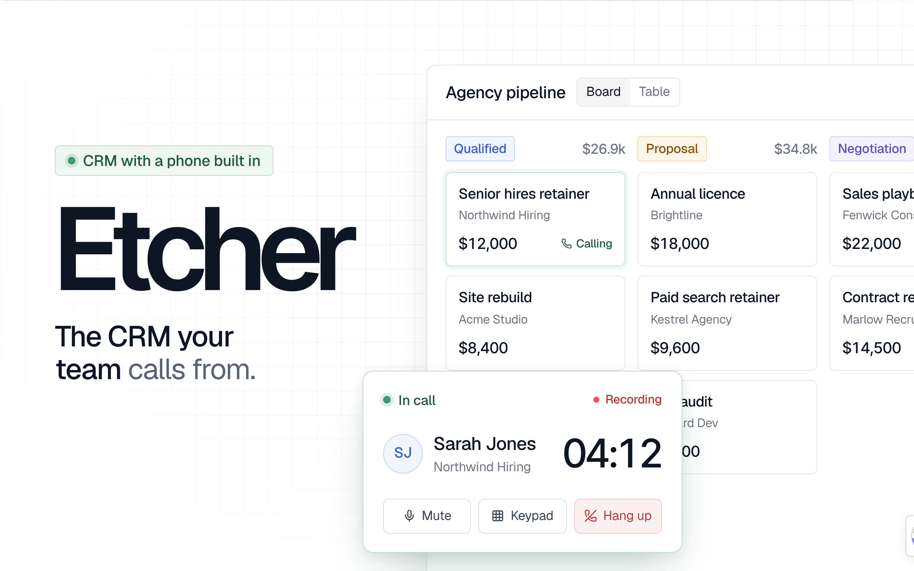

- **Category:** Business Tools
- **Tagline:** The CRM your team calls from
- **Card description:** A fast B2B CRM for sales teams of 2 to 20 with pipelines, CSV import and click-to-call from the browser, at one flat price for unlimited seats.
- **Price:** from $149/mo after a 7-day trial
- **Extra APIs:** Twilio Voice
- **Build time:** about 40 hours · Advanced

**Why it sells:** A 6 person recruitment team on a $90 per seat CRM plus a $40 per seat dialer pays $780 a month. Etcher is $149 for the whole team with 1,000 call minutes included, a saving of over $7,500 a year that a head of sales can see in one call.

**Who it suits:** Founders who want to sell a higher-ticket B2B tool to recruitment agencies, marketing agencies and small B2B sales teams that live on the phone.

**Features**

- People, companies and deals with custom fields, search, filters and a 30 day bin
- CSV import with column mapping, dedupe by email and domain, and a live progress bar
- Multiple pipelines from templates with drag-and-drop kanban, win probabilities and a weighted forecast
- Click-to-call from the browser with local US and UK numbers bought in-app
- Call recording with a consent announcement, saved to the timeline and removed from Twilio
- Inbound calls routed to the assigned rep, with voicemail and call-back tasks
- Reports: pipeline by stage, win rate, cycle time, calls per rep, revenue by month, weekly digest
- Unlimited seats with owner, admin and member roles, audit log, export and account deletion

**Plans**

| Plan | Price | Includes |
|---|---|---|
| Monthly | $149/mo | Unlimited seats, 1,000 call minutes a month, up to 3 numbers, recording, all CRM features, free HubSpot migration |
| Annual | $949/yr | Everything in Monthly, billed yearly ($79/month equivalent) |

### Factorie

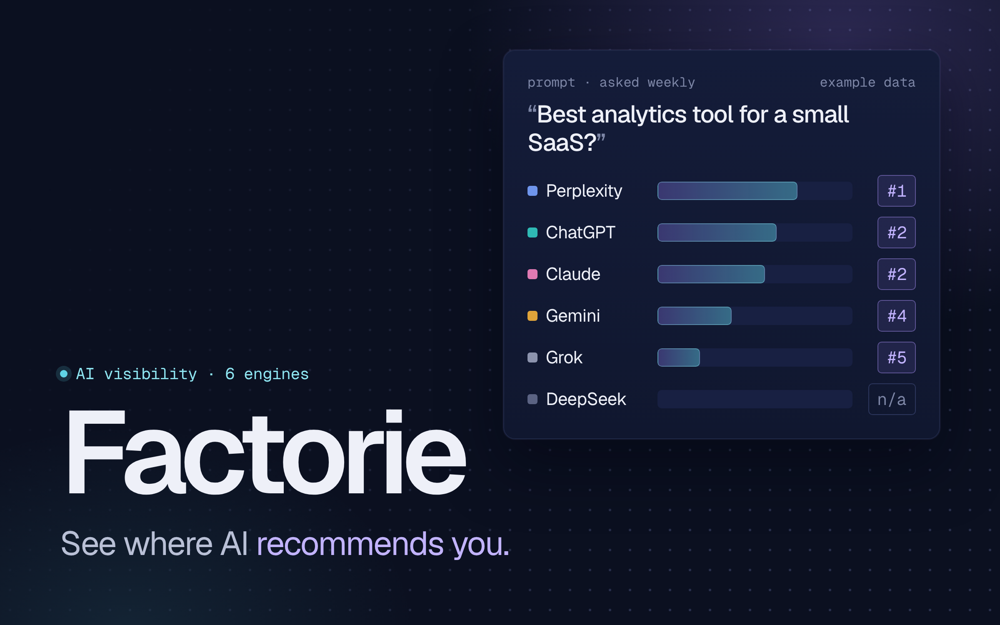

- **Category:** AI Agents
- **Tagline:** See where AI recommends you
- **Card description:** Tracks whether ChatGPT, Perplexity, Gemini, Claude, DeepSeek and Grok recommend your brand for the questions buyers ask, who they name instead, and what to fix.
- **Price:** from $99/mo after a 7-day trial
- **Extra APIs:** OpenRouter, Claude API, Firecrawl
- **Build time:** about 30 hours · Advanced

**Why it sells:** Buyers now ask ChatGPT "what is the best X for Y" and the answer names 3 to 7 brands. Factorie shows a marketer, in 10 minutes, that a competitor is named in 11 of 15 answers and they are named in 2, which is a $99 problem their boss already asked about. Each Starter customer costs about $7 a month to serve.

**Who it suits:** Founders who want a B2B product with a clear, urgent buyer: marketers, SEO agencies and ecommerce brands who have heard "AI search" and suspect ChatGPT never mentions them..

**Features**

- Onboarding reads your site and writes 20 buyer-style prompts you approve
- Weekly checks on ChatGPT, Perplexity, Gemini, Claude and DeepSeek (Grok on Growth)
- Visibility score, share of voice, average position and mention rate per engine
- Raw answers with your brand in green, competitors in red and every cited source
- Sources page that finds the sites mentioning competitors but not you
- Weekly page recommendations with outlines, from your own data
- Daily digest email and on-demand rechecks with live progress
- Free AI visibility audit page that doubles as your lead magnet

**Plans**

| Plan | Price | Includes |
|---|---|---|
| Starter | $99/mo | 1 brand, 25 tracked prompts, 5 engines (ChatGPT, Perplexity, Gemini, Claude, DeepSeek), weekly checks, 5 competitors, 5 rechecks a day, weekly recommendations, daily digest, CSV export |
| Starter (yearly) | $990/yr | Same as Starter, 2 months free |
| Growth | $199/mo | 3 brands, 60 tracked prompts, all 6 engines (adds Grok), weekly checks plus daily checks on 10 pinned prompts, 50 competitors per brand, 10 rechecks a day, on-demand recommendations, digest to 5 recipients |
| Growth (yearly) | $1,990/yr | Same as Growth, 2 months free |

### Ethereel

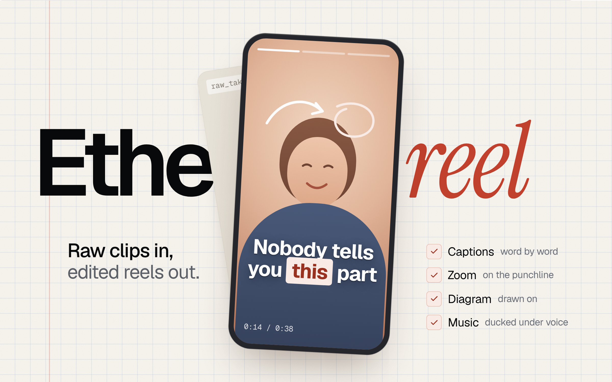

- **Category:** Content & Social
- **Tagline:** Raw clips in, edited reels out
- **Card description:** Upload a raw talking-head clip and get back a captioned reel with zooms, hand-drawn diagrams and music, posted to TikTok and Instagram after you press Pass.
- **Price:** from $89/mo after a 7-day trial
- **Extra APIs:** Trigger.dev, Remotion Lambda (AWS), Groq, Anthropic Claude, Zernio
- **Build time:** about 45 hours · Advanced

**Why it sells:** One reel a day edited by hand is about 25 hours a month. Ethereel does it for $89 (about $3 a reel) while costing about $0.35 a reel to run, and nothing posts until the creator presses Pass.

**Who it suits:** Coaches, consultants, SaaS founders, agency owners and podcasters who film themselves talking to camera and want to post every day without editing.

**Features**

- Silence cutting that keeps a breath around every cut (pauses over 400 ms, threshold 12 dB under your voice)
- Captions in 2 to 4 word pages, spelled your way with your vocabulary and misheard-handle fixes
- Seeded 1.12x punch-ins on your eyes and a slow opening push-in
- Hand-drawn diagram cutaways on an exercise-book page, plus your own screenshots when you mention them
- Opening series title, follow card on your cue line, colour presets and music levelled under your voice
- Review inside a TikTok or Instagram overlay, then Pass, Reject or ask for changes in plain words with Undo
- Queue with five daily slots in your time zone, posted to TikTok and Instagram with live links back
- Exports to the platform spec (H.264 High 4.1, BT.709, -14 LUFS) and validates every file before review

**Plans**

| Plan | Price | Includes |
|---|---|---|
| Creator | $89/mo | 30 videos a month (one a day), clips up to 2 minutes, 2 revisions per video, TikTok + Instagram posting, diagrams and screenshots |
| Creator (yearly) | $890/yr | Same as Creator, 2 months free |
| Pro | $199/mo | 90 videos a month, clips up to 3 minutes, 10 clips per upload, 4 revisions per video, Fast processing (two at a time) |
| Pro (yearly) | $1,990/yr | Same as Pro, 2 months free |

### Conversate

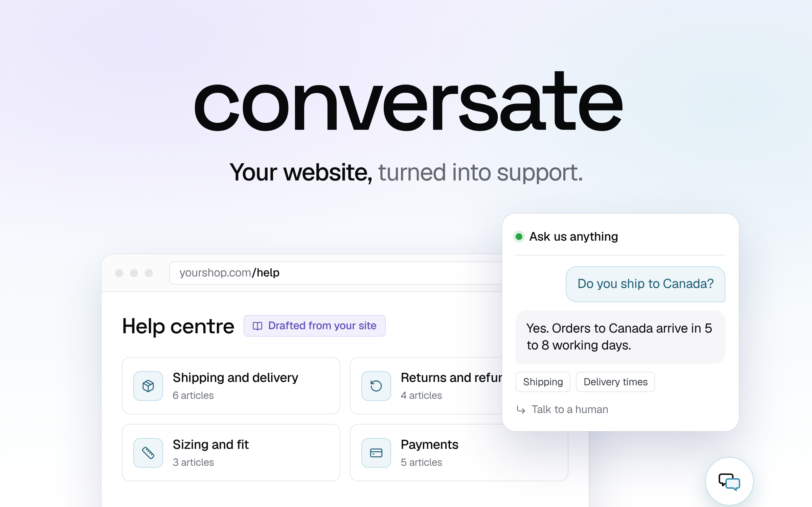

- **Category:** AI Agents
- **Tagline:** Your website, turned into support
- **Card description:** An AI help desk that drafts a help centre from a company's website, answers visitors with sources and a confidence score, and hands the rest to a shared inbox.
- **Price:** from $49/mo after a 7-day trial
- **Extra APIs:** Firecrawl, Voyage AI, Claude API
- **Build time:** about 38 hours · Advanced

**Why it sells:** Intercom's AI agent costs about $0.99 per resolution on top of seats, so 1,000 AI resolutions is roughly $1,000 a month. Conversate includes 1,500 AI answers for $49 a month and drafts the help centre for you, while each answer costs you about $0.0007.

**Who it suits:** Builders who want a serious AI product with obvious value and a big market: bootstrapped SaaS founders, Shopify stores and web agencies who answer the same questions every day and have no proper help centre..

**Features**

- Paste a URL: Firecrawl and Claude draft a categorised, searchable help centre at /your-company/help in about 5 minutes
- One-line script tag widget for HTML, Webflow, WordPress, Shopify, Framer and Next.js, with allowed-domain checks
- AI answers with source links and a confidence score, and "Talk to a human" when it is not sure
- Shared inbox with assign, open/pending/snoozed/closed, notes, flags, tags and canned replies
- Agent replies stream to the widget live over Supabase Realtime, with email fallback and inbound email replies
- AI suggested replies for agents, built from your knowledge and canned replies
- Content gaps report that turns unanswered questions into one-click draft articles
- Analytics: volume, AI resolution rate, first response time and CSAT, plus team roles (owner, admin, agent)

**Plans**

| Plan | Price | Includes |
|---|---|---|
| Starter | $49/mo | 1,500 AI answers, 300 pages learned, 3 seats, 500 suggested replies, 40 AI-drafted articles a month, help centre, widget, inbox |
| Starter (yearly) | $490/yr | Same as Starter, 2 months free |
| Growth | $129/mo | 5,000 AI answers, 1,500 pages, 10 seats, 2,000 suggested replies, 150 drafts a month, no Conversate branding |
| Growth (yearly) | $1,290/yr | Same as Growth, 2 months free |
| Scale | $299/mo | 15,000 AI answers, 5,000 pages, 25 seats, 6,000 suggested replies, 500 drafts a month, no branding |
| Scale (yearly) | $2,990/yr | Same as Scale, 2 months free |

### Outbounder

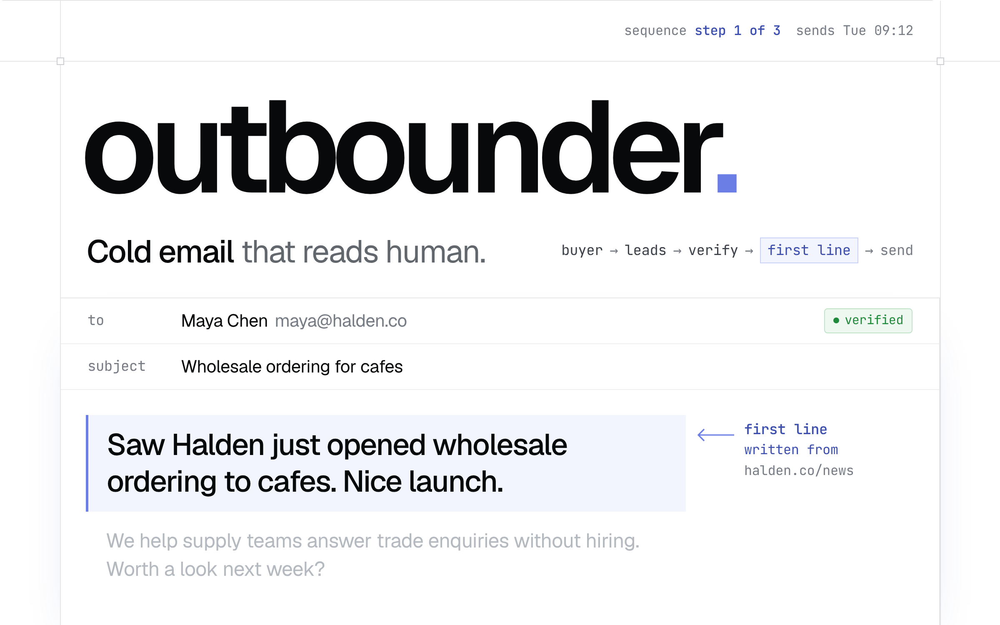

- **Category:** Sales & Outreach
- **Tagline:** Cold email that reads human
- **Card description:** Describe your buyer and Outbounder finds verified leads, writes a first line from each company's website and sends from safe inboxes on your own outreach domain.
- **Price:** from $79/mo after a 7-day trial
- **Extra APIs:** Prospeo, MillionVerifier, Firecrawl, Anthropic Claude, AgentMail
- **Build time:** about 30 hours · Advanced

**Why it sells:** A personalised first line takes 3 to 5 minutes by hand, so 100 leads a week is a full working day. Outbounder does 25 in about 2 minutes and replaces a $150 to $300 a month stack (lead database, verifier, sequencer, inboxes) for $79.

**Who it suits:** Founders who want a technical but very sellable SaaS: B2B founders, agency owners and recruiters who already do their own cold email and hate gluing four tools together..

**Features**

- Describe your ICP and get verified B2B leads from Prospeo, double-checked with MillionVerifier
- A first line for every lead written by Claude from facts on their own website, with the source shown
- Keyboard-first review queue: nothing sends until you approve it
- Separate outreach domains and inboxes set up through AgentMail, with every DNS record to copy into Porkbun
- Safe sending: 20 a day per new inbox ramping to 30, send windows in each lead's time zone, plain text, no tracking
- Unsubscribe link and one-click List-Unsubscribe header on every email, with bounces and opt-outs suppressed everywhere
- Unified inbox where Claude labels replies interested, not now, unsubscribe or out of office, and any reply stops the sequence
- Usage meters and hard plan caps on every paid API call, so no surprise bills

**Plans**

| Plan | Price | Includes |
|---|---|---|
| Starter | $79/mo | 350 verified leads, 525 AI-written emails, 1,000 sends, 2 domains, 3 inboxes, 3 active campaigns |
| Growth | $179/mo | 900 verified leads, 1,350 AI-written emails, 2,700 sends, 3 domains, 6 inboxes, 10 active campaigns |
| Starter (annual) | $790/yr | Starter limits every month, 2 months free |
| Growth (annual) | $1,790/yr | Growth limits every month, 2 months free |

### Signet

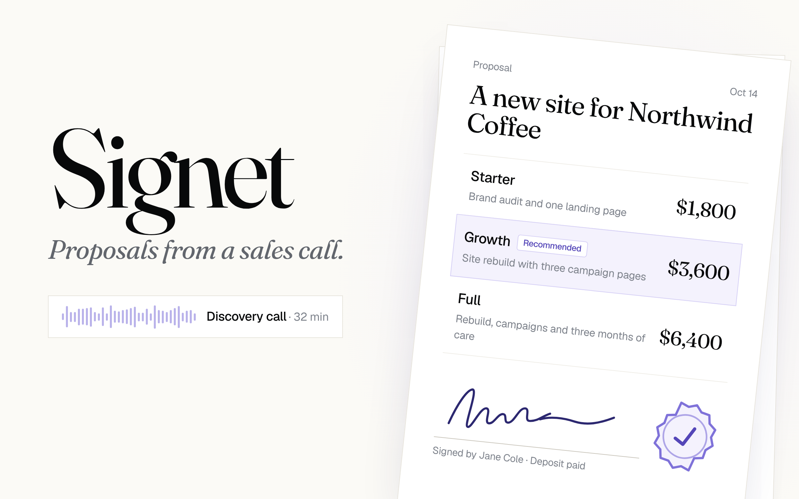

- **Category:** Business Tools
- **Tagline:** Proposals from a sales call
- **Card description:** Upload a discovery call and get a branded proposal with three priced options, view tracking, e-signature and a deposit paid to your own Stripe.
- **Price:** from $49/mo after a 7-day trial
- **Extra APIs:** AssemblyAI, Claude API (Anthropic), Stripe Connect, Zoom API, Google Meet and Drive APIs
- **Build time:** about 25 hours · Intermediate

**Why it sells:** A freelancer sending 8 proposals a month spends about 24 hours writing them. Signet costs $49 and turns each 45 minute call into a priced draft in about 10 minutes, and one extra $5,000 project a quarter ($20,000 a year) pays for it more than 30 times over.

**Who it suits:** People who want a first B2B SaaS sold to a market they can reach directly: agency owners, freelancers and consultants who run discovery calls and send proposals every week..

**Features**

- Upload, record in the browser, or import a Zoom or Google Meet recording
- Transcript with speakers, plus a brief of goals, pains, budget signals, scope and timeline
- Branded draft with exec summary, problem, solution, scope, timeline, terms and next steps
- Good, better and best pricing built only from your own service catalogue and rules
- Block editor with one-click AI rewrite per section and a diff before you keep it
- Share link with view tracking and time spent on each section
- Typed and drawn e-signature with a tamper-evident fingerprint, then a deposit paid to your own Stripe
- Automatic follow-up after 3 days, team workspaces, templates and win-rate analytics

**Plans**

| Plan | Price | Includes |
|---|---|---|
| Solo | $49/mo | 1 seat, 10 proposals from calls, 600 call minutes, 100 AI rewrites a month, e-signature, deposits, tracking, 5 templates |
| Solo (yearly) | $490/yr | Same as Solo, 2 months free |
| Studio | $99/mo | 3 seats, 25 proposals from calls, 1,500 call minutes, 250 rewrites, Zoom and Meet import, no Signet footer, per-person analytics |
| Studio (yearly) | $990/yr | Same as Studio, 2 months free |
| Agency | $199/mo | 10 seats, 50 proposals from calls, 3,000 call minutes, 500 rewrites, everything in Studio, meeting bot when it ships |
| Agency (yearly) | $1,990/yr | Same as Agency, 2 months free |

### Folio

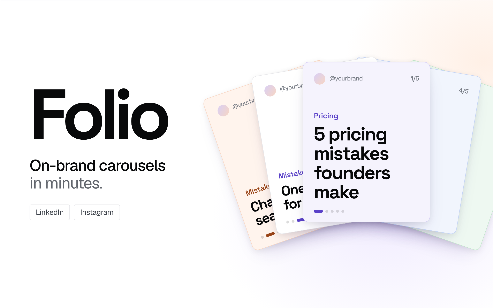

- **Category:** Content & Social
- **Tagline:** On-brand carousels in minutes
- **Card description:** Turns blog posts, YouTube videos, ideas and voice notes into on-brand LinkedIn and Instagram carousels, then schedules them.
- **Price:** from $39/mo after a 7-day trial
- **Extra APIs:** Claude API (Anthropic), Firecrawl, Supadata, Deepgram, Zernio
- **Build time:** about 22 hours · Intermediate

**Why it sells:** Three carousels a week at 90 minutes each in Canva is about 19 hours a month. Folio makes one in about 3 minutes for $39 a month, less than an hour of a designer's time, and agencies pay $249 to run 10 client brands.

**Who it suits:** Founders, coaches and LinkedIn agencies who already post every week and want each blog post, video or voice note to become a carousel in their own brand..

**Features**

- Brand kit set once: logo, colours, fonts, headshot and handle on every slide
- Four sources: blog URL, YouTube video, a typed idea or a voice note
- Claude writes a hook, 6 to 9 body slides and a CTA, with a layout chosen per slide
- 8 slide layouts: hook, statement, list, step, quote, stat, compare, CTA
- Per-slide editing with AI rewrite, undo and drag to reorder
- Export PNG slides and a LinkedIn PDF document in one click
- Content calendar that schedules to LinkedIn profiles, pages and Instagram
- Library of every carousel with impressions, reactions and clicks

**Plans**

| Plan | Price | Includes |
|---|---|---|
| Creator | $39/mo | 15 carousels, 100 AI rewrites, 60 exports, 30 voice minutes, 1 brand kit, 1 connected account |
| Creator (yearly) | $390/yr | Same as Creator, 2 months free |
| Pro | $79/mo | 50 carousels, 400 rewrites, 200 exports, 120 voice minutes, 3 brand kits, 3 accounts, 2 seats, analytics, custom fonts |
| Pro (yearly) | $790/yr | Same as Pro, 2 months free |
| Agency | $249/mo | 150 carousels, 1,000 rewrites, 1,000 exports, 400 voice minutes, 10 brand kits, 10 accounts, 5 seats, analytics |
| Agency (yearly) | $2,490/yr | Same as Agency, 2 months free |

### Bookwell

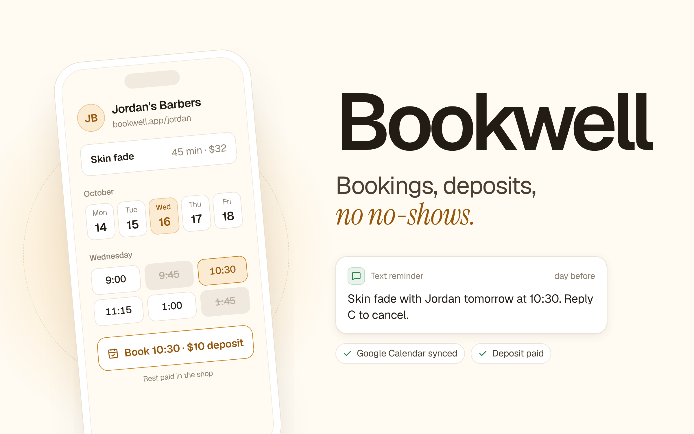

- **Category:** Productivity & Booking
- **Tagline:** Bookings, deposits, no no-shows
- **Card description:** Booking pages for barbers, trainers and tutors with Google Calendar sync, deposits and SMS reminders.
- **Price:** from $19/mo after a 7-day trial
- **Extra APIs:** Google Calendar API, Twilio (SMS), Stripe Connect
- **Build time:** about 20 hours · Intermediate

**Why it sells:** A barber charging $35 who loses 4 slots a month to no-shows is down $140. Bookwell costs $19 and the $10 deposit plus a reminder text cuts no-shows by more than half.

**Who it suits:** People who want a first SaaS with a clear local market: barbers, personal trainers, tutors and other one-person service businesses..

**Features**

- Public booking page at bookwell.app/b/yourname with a printable QR code
- Services with duration, price, deposit and buffer time
- Google Calendar two-way: busy times block slots, bookings appear in your calendar
- Deposits paid by card straight to the owner's bank via Stripe Connect
- SMS confirmation and reminder with a manage link, and "Reply C to cancel"
- Double booking is impossible, enforced by the database
- Mark completed or no-show, and a no-show report on Studio

**Plans**

| Plan | Price | Includes |
|---|---|---|
| Solo | $19/mo | Unlimited bookings, up to 300 texts a month (150 bookings with confirmation + reminder), deposits, Google Calendar sync |
| Solo (yearly) | $190/yr | Same as Solo, 2 months free |
| Studio | $39/mo | Everything in Solo, up to 600 texts a month (300 bookings), brand colour and logo, no Bookwell footer, no-show report |
| Studio (yearly) | $390/yr | Same as Studio, 2 months free |

### Helpdeck

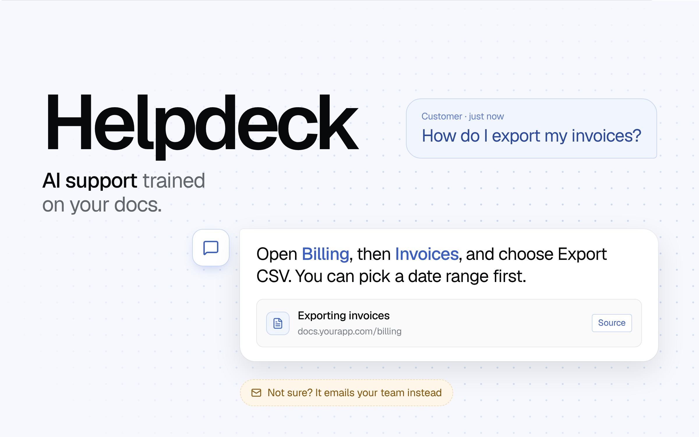

- **Category:** AI Agents
- **Tagline:** AI support trained on your docs
- **Card description:** A chat widget that learns a company's website, answers customers with sources, and emails a human when unsure.
- **Price:** from $49/mo after a 7-day trial
- **Extra APIs:** Firecrawl, Claude API, Voyage AI
- **Build time:** about 18 hours · Intermediate

**Why it sells:** A support ticket costs a small company about $5 of someone's time. Deflect 30 of them a month and Helpdeck has paid for itself at $49, while Intercom's AI agent starts near $0.99 per resolution on top of seat fees.

**Who it suits:** Builders who want an AI product with obvious value: SaaS founders, agencies and online shops drowning in repeat support questions..

**Features**

- Paste a URL and the whole site is crawled and learned in minutes
- One-line script tag install for any website
- Answers cite the exact docs pages they came from
- Says "I'm not sure" instead of guessing, then offers email handoff
- Handoff emails include the full transcript with reply-to set to the visitor
- Conversations inbox and a ranked "docs gaps" list of questions your docs miss
- Widget only works on domains you allow
- Re-crawls only re-learn changed pages, with hard monthly caps so costs never run away

**Plans**

| Plan | Price | Includes |
|---|---|---|
| Starter | $49/mo | 1 bot, up to 200 pages, 2,000 answers a month, email handoff, conversations inbox |
| Starter (yearly) | $490/yr | Same as Starter, 2 months free |
| Growth | $129/mo | 3 bots, up to 1,000 pages per bot, 10,000 answers a month, no Helpdeck footer, weekly docs-gaps email |
| Growth (yearly) | $1,290/yr | Same as Growth, 2 months free |

### Sparring

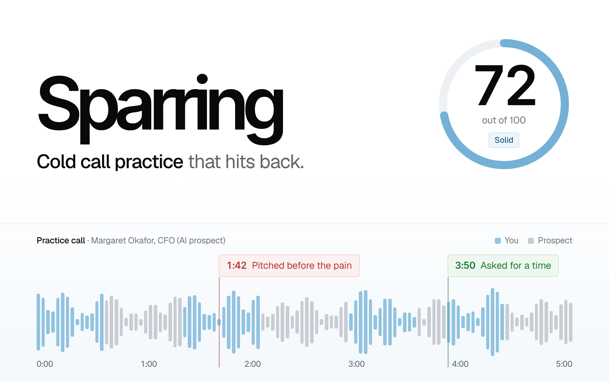

- **Category:** Sales & Outreach
- **Tagline:** Cold call practice that hits back
- **Card description:** Reps cold call a realistic AI prospect in the browser, get scored out of 100 with coaching notes on the exact second, and managers assign drills and watch the leaderboard.
- **Price:** from $49/mo after a 7-day trial
- **Extra APIs:** ElevenLabs Agents Platform, Claude API (Anthropic)
- **Build time:** about 35 hours · Advanced

**Why it sells:** A new SDR costs about $5,000 a month and takes about 3 months to ramp, practising on real prospects. Team is $199 a month for 5 reps: if 15 minutes a day gets one rep to their first meeting a week sooner, it has paid for itself several times over.

**Who it suits:** People who want a first B2B SaaS sold to a buyer they can reach directly: SDR and BDR team leads, sales bootcamps and coaches, and founders who have to learn to cold call themselves..

**Features**

- Built-in personas (sceptical CFO, busy founder, gatekeeper) and scenarios (cold call, discovery, objection drill) at three difficulties
- Live voice roleplay in the browser with about a one second reply, interruptions and hang-ups
- Score out of 100 on opener, permission, pain discovery, objection handling and next step
- Three to eight coaching notes pinned to the exact second, with the better line to say
- Recording and transcript for every call, with notes that jump the audio
- Custom personas drafted from your ICP and the real objections your team hears
- Assignments with pass scores and due dates, a weekly leaderboard, streaks and score trends per rep
- Pooled voice minutes with a hard cap, a live meter, and a Monday team report by email

**Plans**

| Plan | Price | Includes |
|---|---|---|
| Solo | $49/mo | 1 seat, 90 voice minutes a month, calls up to 10 minutes, 3 custom personas, 5 persona drafts, scorecards and recordings |
| Solo (yearly) | $490/yr | Same as Solo every month, 2 months free |
| Team | $199/mo | 6 seats, 360 pooled voice minutes, calls up to 15 minutes, 25 custom personas, 30 drafts, assignments, leaderboard, trends, weekly report |
| Team (yearly) | $1,990/yr | Same as Team every month, 2 months free |
| Floor | $499/mo | 16 seats, 900 pooled voice minutes, calls up to 20 minutes, 500 custom personas, 100 drafts, everything in Team |
| Floor (yearly) | $4,990/yr | Same as Floor every month, 2 months free |

### Marquee

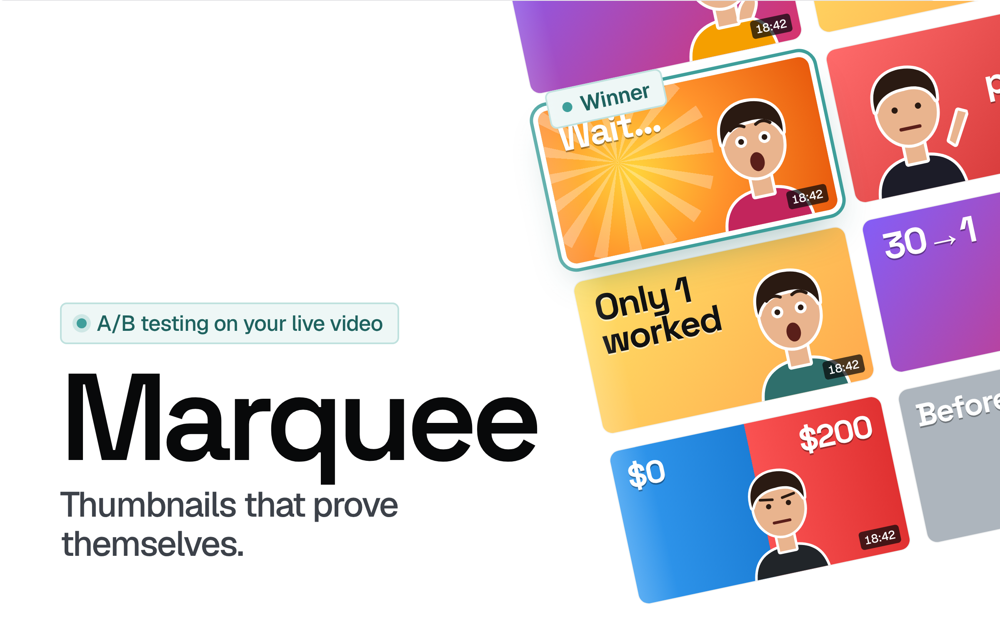

- **Category:** Content & Social
- **Tagline:** Thumbnails that prove themselves
- **Card description:** Type a video title and get six YouTube thumbnail concepts with your real face cut out, polish one in a canvas editor, then A/B test them on your live video until a winner is proven.
- **Price:** from $29/mo after a 7-day trial
- **Extra APIs:** fal.ai, Claude API (Anthropic), YouTube Data, Analytics and Reporting APIs (Google Cloud)
- **Build time:** about 33 hours · Advanced

**Why it sells:** A creator posting 8 videos a month spends 6 to 10 hours a week on thumbnails or $400+ a month on a designer, and still guesses. Moving one video from 4% to 6% CTR is 50% more views from the same impressions, and Marquee costs $29 a month and proves which thumbnail does it.

**Who it suits:** People who want a first SaaS sold to a market they already watch every day: YouTubers with 10k to 500k subscribers who appear on camera, and small agencies or editors who run several channels..

**Features**

- Face library: upload 5 to 10 photos once, each cut out cleanly and tagged by expression
- Six concepts per title, each a different angle, composed with your real face and a bold headline
- Canvas editor: move and scale layers, swap expressions, text presets, brand colours and fonts, phone preview
- Export at 1280x720 that is always under 2 MB, or push it straight into a test
- A/B tests on your live video: one thumbnail per day in a balanced order, via the YouTube API
- Impressions and CTR from YouTube's own reports, with a plain-English "how sure" and a watch-time guardrail
- Winner applied automatically, original always backed up and restored if you stop
- Agency plan: 10 channels, 5 seats, a face library per presenter

**Plans**

| Plan | Price | Includes |
|---|---|---|
| Creator | $29/mo | 1 seat, 1 channel, 84 concepts (14 videos), 3 live tests, 10 face cut-outs a month, 4 brand fonts |
| Creator (yearly) | $290/yr | Same as Creator, 2 months free |
| Pro | $59/mo | 2 seats, 3 channels, 168 concepts (28 videos), 10 live tests, 20 face cut-outs, 3 people in the face library, 10 fonts |
| Pro (yearly) | $590/yr | Same as Pro, 2 months free |
| Agency | $149/mo | 5 seats, 10 channels, 420 concepts (70 videos), 40 live tests, 40 face cut-outs, 15 people, 30 fonts, roles |
| Agency (yearly) | $1,490/yr | Same as Agency, 2 months free |

### Harvest

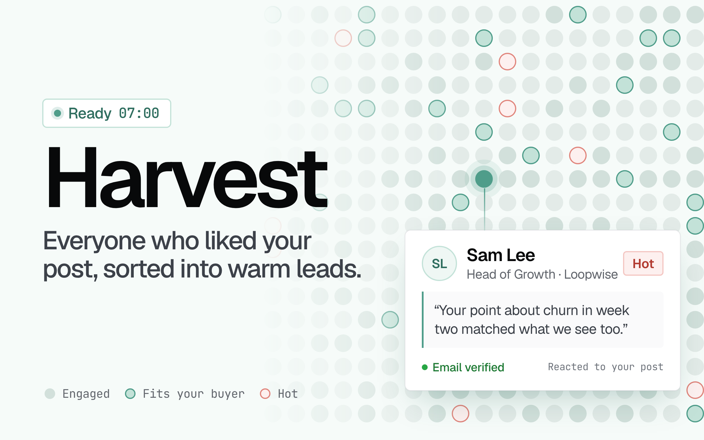

- **Category:** Sales & Outreach
- **Tagline:** Warm leads from LinkedIn posts
- **Card description:** Track the LinkedIn posts and creators you choose, and every morning get the people who engaged who fit your buyer, with role, company, a verified email and an opener about what they reacted to.
- **Price:** from $59/mo after a 7-day trial
- **Extra APIs:** Apify (LinkedIn post actors), Prospeo, MillionVerifier, Claude API (Anthropic), HubSpot and Pipedrive (customer tokens)
- **Build time:** about 32 hours · Advanced

**Why it sells:** A founder whose posts get 300 reactions a week is ignoring about 1,200 warm people a month. Harvest turns them into about 20 scored, emailable leads every morning for $59, and one closed $3,000 deal pays for more than four years of Solo.

**Who it suits:** People who want a first B2B SaaS sold to a market they already watch every day: B2B founders, small agency owners and recruiters who post on LinkedIn and know their competitors' posts are full of buyers..

**Features**

- Track your own posts, competitors' posts and whole creators: every new post is collected at 1, 3 and 7 days old
- Never logs in to LinkedIn as you: no cookies, no extension, no automated invites or DMs
- Plain-English ICP turned into titles, seniority, company size, industries and countries, with a tunable threshold
- Cheap headline prefilter first, so only likely buyers are enriched with role, company, size and a work email
- Every email double-checked by a verifier; invalid addresses removed, catch-all marked
- Score, reasons and an opener that mentions the post topic or their comment, guarded against prompt injection
- 7am digest with the top 20 new warm leads, plus Today, Leads, Lists and live run status in the app
- CSV export, HubSpot and Pipedrive push, signed webhooks, customer suppression and one-click forget

**Plans**

| Plan | Price | Includes |
|---|---|---|
| Solo | $59/mo | 1 seat, 15 sources, 1,500 engagers collected, 300 leads enriched, 1 ICP, daily digest, CSV and signed webhooks |
| Solo (yearly) | $590/yr | Same as Solo, 2 months free |
| Growth | $129/mo | 3 seats, 50 sources, 4,000 engagers, 600 leads enriched, 3 ICPs, HubSpot and Pipedrive push, 3 digest recipients |
| Growth (yearly) | $1,290/yr | Same as Growth, 2 months free |
| Agency | $249/mo | 10 seats, 150 sources, 10,000 engagers, 950 leads enriched, 10 ICPs (one per client), everything in Growth |
| Agency (yearly) | $2,490/yr | Same as Agency, 2 months free |

### Echo

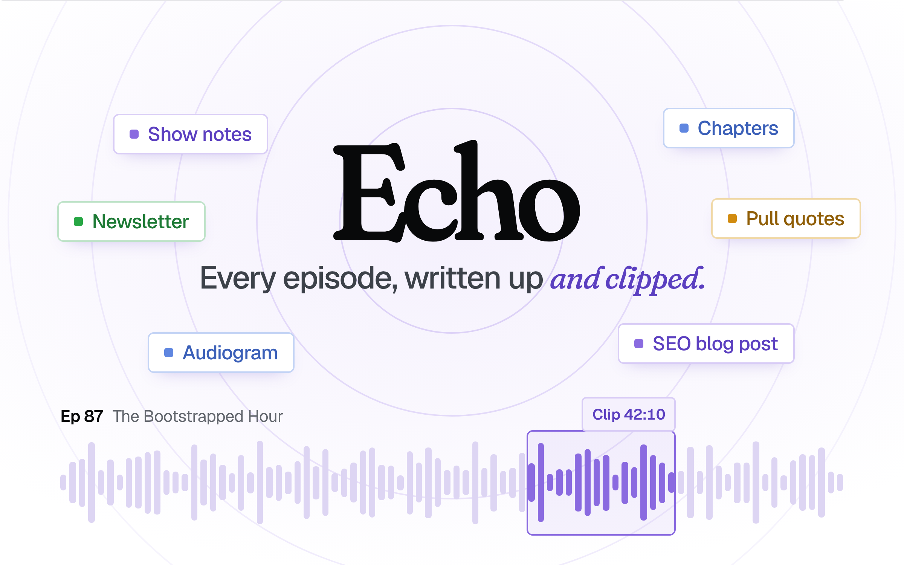

- **Category:** Content & Social
- **Tagline:** Every episode, written up and clipped
- **Card description:** Upload a podcast episode or connect an RSS feed and get show notes, chapters, quotes, a newsletter, social posts, an SEO blog post and captioned audiograms in the host's own voice.
- **Price:** from $29/mo after a 7-day trial
- **Extra APIs:** AssemblyAI, Claude API (Anthropic), Remotion Lambda (on AWS)
- **Build time:** about 28 hours · Advanced

**Why it sells:** A weekly show spends about 16 hours a month writing show notes, posts and newsletters and cutting clips. Echo does all of it in about 20 minutes an episode for $29 a month, and an agency with 20 client shows replaces most of a $3,000 a month content role with a $199 plan.

**Who it suits:** People who want a first B2B SaaS in a market they can reach from public data: indie podcasters, B2B podcast agencies and marketing teams at companies with a branded show..

**Features**

- Upload a file up to 1 GB, or connect an RSS feed and new episodes import themselves every 15 minutes
- Transcript with speaker names you set once, word timestamps and search
- Five title options, show notes, chapters and five pull quotes checked word for word against the transcript
- Newsletter draft, five social posts and an SEO blog post, all in the host's voice from a writing sample
- Regenerate any asset with an instruction, with 10 versions of history and Undo
- Vertical 1080x1920 audiograms with a moving waveform and word-by-word captions in three styles
- Public episode pages with the full transcript, chapters.json and transcript files, and an embeddable player that streams from your own host
- Workspaces with up to 25 shows and 10 people for agencies and companies, with usage caps shown before you hit them

**Plans**

| Plan | Price | Includes |
|---|---|---|
| Creator | $29/mo | 1 show, 1 seat, 6 audio hours, episodes up to 2 hours, 20 audiograms, 25 regenerations a month, RSS auto-import, public pages with a Made with Echo badge |
| Creator (yearly) | $290/yr | Same as Creator, 2 months free |
| Studio | $79/mo | 5 shows, 3 seats, 20 audio hours, episodes up to 3 hours, 50 audiograms, 50 regenerations a month, badge optional |
| Studio (yearly) | $790/yr | Same as Studio, 2 months free |
| Agency | $199/mo | 25 shows, 10 seats, 50 audio hours, episodes up to 4 hours, 150 audiograms, 100 regenerations a month, badge optional |
| Agency (yearly) | $1,990/yr | Same as Agency, 2 months free |

### Halo

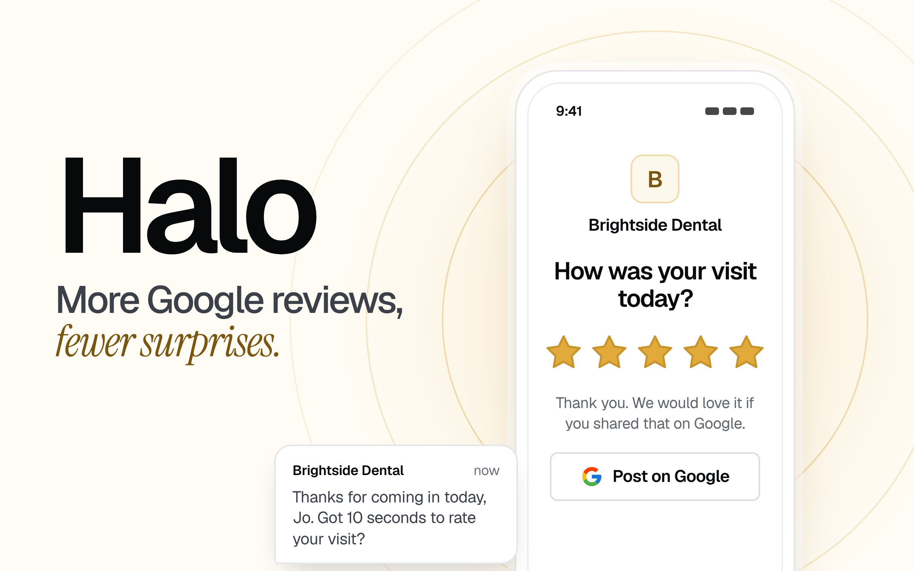

- **Category:** AI Agents
- **Tagline:** More Google reviews, fewer surprises
- **Card description:** Texts every customer after their visit with a two-tap way to rate you and post a Google review, alerts you to unhappy customers privately, and drafts replies to new reviews in your voice.
- **Price:** from $49/mo after a 7-day trial
- **Extra APIs:** Twilio (SMS), Google Business Profile APIs, Claude API (Anthropic)
- **Build time:** about 32 hours · Advanced

**Why it sells:** A dental practice with 600 visits a month that asks every patient turns about 5% into Google reviews: 30 new reviews a month instead of 2 or 3. Halo costs $49 and one extra new patient (often worth $500+ a year) pays for it many times over, while Birdeye and Podium start at $299 to $399 a month [verify].

**Who it suits:** People who want a first B2B SaaS sold to a market they can phone, walk into or email today: dental and medical practices, salons, trades and home services, and the local marketing agencies that serve them..

**Features**

- Review requests by text and email two hours after each visit, inside your sending hours
- Same "Post a review on Google" button for every customer, whatever they rate, so you stay inside Google's rules
- Private feedback from any customer, with an instant alert for 3 stars or fewer
- Visits in by Zapier, webhook, CSV upload or one-tap manual send
- Texts from a toll-free number registered in your business name, with STOP handled for you
- AI reply drafts for new Google reviews in your tone, approved by you before they post
- Dashboard per location: sent, opened, clicked to Google, feedback, new reviews and rating trend
- Multi-location and agency workspaces with weekly client reports and no Halo branding

**Plans**

| Plan | Price | Includes |
|---|---|---|
| Solo | $49/mo | 1 location, 200 review requests and 30 AI reply drafts a month, SMS from your own verified number, email, private feedback alerts, Zapier and webhook intake, CSV import, 2 seats |
| Solo (yearly) | $490/yr | Same as Solo, 2 months free |
| Growth | $99/mo | Up to 3 locations, 500 requests and 120 AI drafts a month, location comparison, daily digest, 5 seats |
| Growth (yearly) | $990/yr | Same as Growth, 2 months free |
| Agency | $299/mo | Up to 10 client locations, each with its own number, 1,000 requests and 300 AI drafts a month, weekly client reports, no Halo branding, 10 seats |
| Agency (yearly) | $2,990/yr | Same as Agency, 2 months free |

### Tally

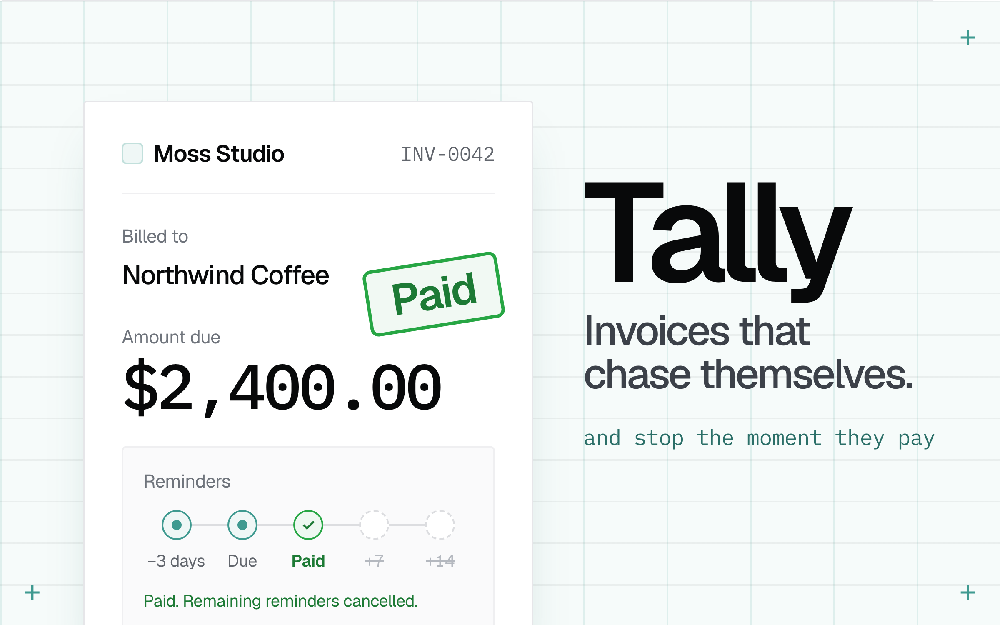

- **Category:** Business Tools
- **Tagline:** Invoices that chase themselves
- **Card description:** Branded invoices sent from your own email domain, with polite, escalating reminders that stop the moment the client pays or replies, and payments straight into your own Stripe.
- **Price:** from $19/mo after a 7-day trial
- **Extra APIs:** Stripe Connect, Resend Domains and Inbound, Claude API (Anthropic)
- **Build time:** about 30 hours · Advanced

**Why it sells:** A freelancer with $12,000 outstanding at any time spends an hour or two a week writing chase emails. Tally costs $19 a month, sends every polite, escalating reminder from their own email address, and shows their real average days to pay, so the value is measured on their own invoices rather than promised.

**Who it suits:** People who want a first B2B SaaS sold to a market they can reach directly: freelancers, consultants and small agencies who send invoices every month and hate chasing late payers..

**Features**

- Branded invoices with line items, per-line tax, discounts and a PDF, sent from your own verified domain
- Hosted pay page with card and bank payments (ACH, SEPA, Bacs where available) straight into your own Stripe
- Five-step reminder sequence (before due, on the day, +3, +7, +14) that gets firmer each time, editable per client
- Reminders stop on payment and pause on reply; "I will pay Friday" pauses until Saturday
- Deposits, partial payments, optional capped late fees and recurring invoices
- Multi-currency invoicing with dashboard totals in your currency from daily ECB rates
- Dashboard with outstanding, overdue, average days to pay and an 8 week cash forecast
- Client CSV import and accountant exports in generic, Xero and QuickBooks layouts

**Plans**

| Plan | Price | Includes |
|---|---|---|
| Solo | $19/mo | 1 seat, 50 invoices sent a month, 1 reminder sequence, 1 sending domain, 100 replies read by AI, 10 voice rewrites, unlimited clients, card and bank payments, recurring, deposits, part payments, late fees, multi-currency, CSV exports |
| Solo (yearly) | $190/yr | Same as Solo, 2 months free |
| Studio | $39/mo | 3 seats, 250 invoices sent a month, 5 sequences, 1 sending domain, 500 replies read, 30 voice rewrites, remove the "Sent with Tally" line, Xero and QuickBooks sync when it ships |
| Studio (yearly) | $390/yr | Same as Studio, 2 months free |
| Agency | $79/mo | 10 seats, 750 invoices sent a month, unlimited sequences, 3 sending domains (one per brand), 1,500 replies read, 60 voice rewrites, everything in Studio |
| Agency (yearly) | $790/yr | Same as Agency, 2 months free |

### Shortlist

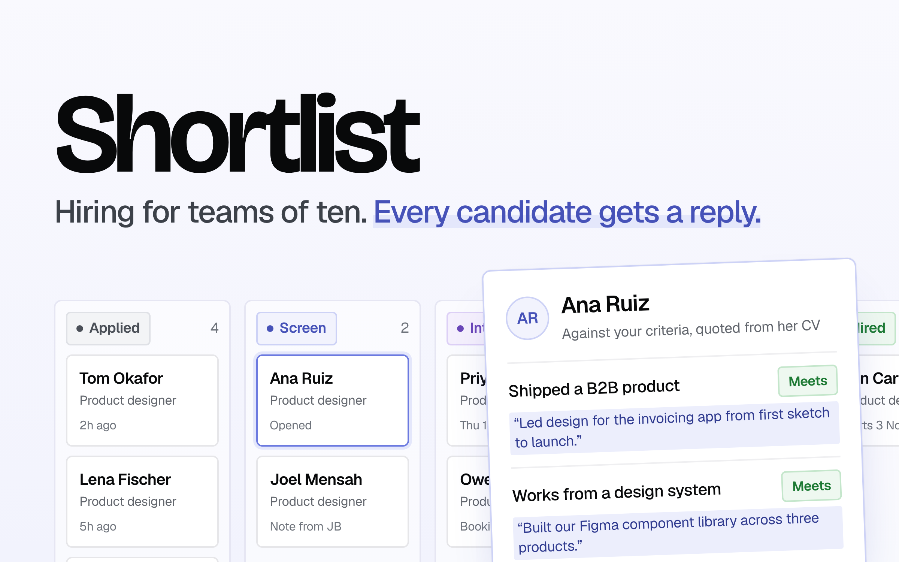

- **Category:** Business Tools
- **Tagline:** Hiring for teams of ten
- **Card description:** A careers page, an applicant board and quoted AI summaries of every CV against your own criteria, with self-booked interviews and GDPR deletion on autopilot. A person makes every decision.
- **Price:** from $29/mo after a 7-day trial
- **Extra APIs:** Claude API (Anthropic), Google Calendar API
- **Build time:** about 34 hours · Advanced

**Why it sells:** A 10 person company hiring 3 roles a year reads about 400 CVs and sends 60+ scheduling emails, usually from a Gmail label. Shortlist does that job for $29 a month, about a tenth of Workable's entry price for new customers (around $299 a month [verify]), and every one of those founders announces they are hiring in public.

**Who it suits:** People who want a first B2B SaaS sold to a market they can find every day: startup founders, operations leads and agency owners hiring their first 10 people, who post open roles publicly on LinkedIn and job boards..

**Features**

- Hosted careers page and job pages with custom questions, Google for Jobs markup and a mobile apply form
- CV upload to private storage, opened only by the hiring team for that job
- Pipeline board per job (applied, screen, interview, offer, hired, rejected) with drag and drop and live updates
- Quoted AI summary of each CV against your criteria: per-criterion labels with evidence, no scores, no auto-reject
- Bias lint on job criteria, redaction before the AI, candidate opt-out and blind scorecards
- Candidates self-book interviews from every interviewer's Google Calendar, with a Meet link created for you
- Six editable candidate email templates through Resend, with a 2 hour undo on rejections
- GDPR on autopilot: retention timers, access and deletion requests in two clicks, and a deletion log

**Plans**

| Plan | Price | Includes |
|---|---|---|
| Starter | $29/mo | 3 seats, 2 open jobs, 150 AI summaries and 450 applications a month, careers page, scorecards, Google Calendar booking, GDPR tools |
| Starter (yearly) | $290/yr | Same as Starter, 2 months free |
| Team | $69/mo | 10 seats, 8 open jobs, 500 AI summaries and 1,500 applications a month, no Shortlist branding, pass-through report |
| Team (yearly) | $690/yr | Same as Team, 2 months free |
| Growth | $149/mo | 25 seats, 25 open jobs, 1,500 AI summaries and 4,500 applications a month, everything in Team |
| Growth (yearly) | $1,490/yr | Same as Growth, 2 months free |

### Rota

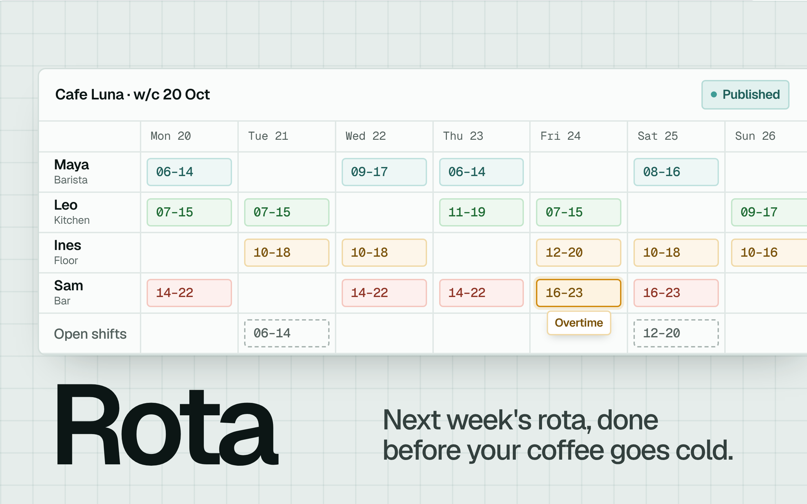

- **Category:** Productivity & Booking
- **Tagline:** Staff rotas built in minutes
- **Card description:** Drag-and-drop weekly rotas with clash and overtime warnings, a Claude-drafted week, shift texts and reminders, swaps on staff phones, geofenced clock-in and a payroll CSV.
- **Price:** from $39/mo after a 7-day trial
- **Extra APIs:** Twilio Programmable Messaging, Claude API (Anthropic)
- **Build time:** about 38 hours · Advanced

**Why it sells:** A manager of a 20 person cafe spends about 3 hours a week building the rota and chasing swaps, roughly $230 of their time a month at $18 an hour. Rota cuts that to about 30 minutes a week for $69 a site, so it pays for itself nearly 3 times over before counting a single covered no-show.

**Who it suits:** People who want a first B2B SaaS in a local market they can walk into: managers and owners of cafes, restaurants, gyms, studios, salons and small clinics with 5 to 50 hourly staff who still build the rota in a spreadsheet and sort swaps in WhatsApp..

**Features**

- Locations, job roles with colours, staff with availability, contract hours, pay rates and time off
- Drag-and-drop weekly rota builder with templates and copy last week
- Live warnings for double booking, holidays, availability, 11 hour rest, overtime and untrained roles
- Wage cost per day and per week against a labour budget
- Draft with Claude: a full week from availability and the last four weeks, reviewed before anything is saved
- Publish texts and emails each person only their own shifts, plus reminders 2 hours before
- Staff phone app for swaps, cover, open shifts, availability and time off, with manager approval
- Clock-in from the phone with an optional geofence, timesheet approval and a payroll CSV

**Plans**

| Plan | Price | Includes |
|---|---|---|
| Starter | $39/mo | Per location: up to 15 staff, 100 texts (400 in the US and Canada), 6 Claude drafts a month, rota builder, swaps, open shifts, time off, clock-in, CSV export |
| Starter (yearly) | $390/yr | Same as Starter, 2 months free |
| Team | $69/mo | Per location: up to 40 staff, 180 texts (720 in the US and Canada), 10 Claude drafts a month, geofenced clock-in, everything in Starter |
| Team (yearly) | $690/yr | Same as Team, 2 months free |
| Pro | $149/mo | Per location: up to 100 staff, 400 texts (1,600 in the US and Canada), 12 Claude drafts a month, texts from your business name, everything in Team |
| Pro (yearly) | $1,490/yr | Same as Pro, 2 months free |

### Dossier

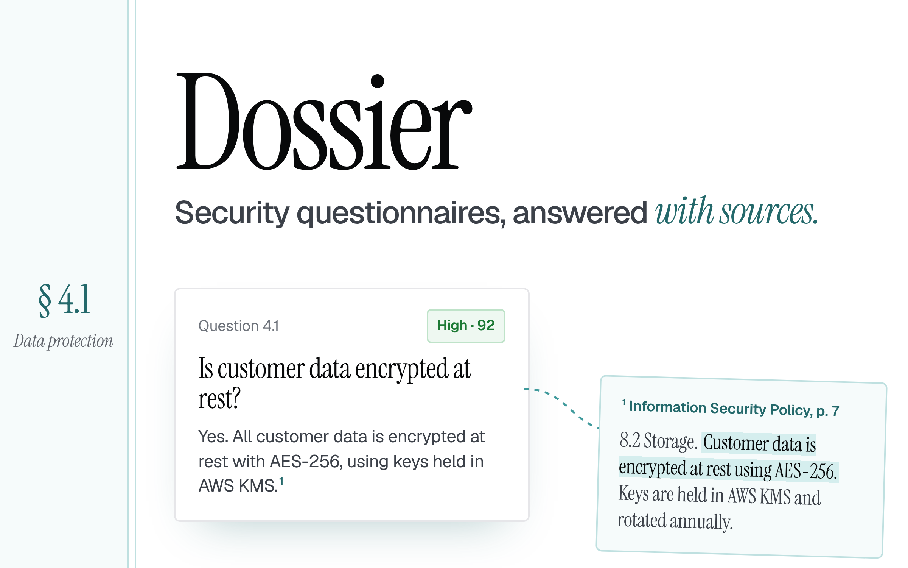

- **Category:** AI Agents
- **Tagline:** Security questionnaires answered with sources
- **Card description:** Upload a buyer's security questionnaire or RFP and get every answer drafted from your own policies, with the source paragraph, a confidence score, a team review flow and the original file exported back filled in.
- **Price:** from $249/mo after a 7-day trial
- **Extra APIs:** Claude API (Anthropic), Voyage AI, LlamaParse (LlamaIndex)
- **Build time:** about 45 hours · Advanced

**Why it sells:** A 250-question security questionnaire takes 10 to 20 hours of senior time, and a SaaS selling upmarket gets several a month. At $599 a month, Dossier costs less than one day of a sales engineer, and Loopio-style tools cost $10,000 to $25,000 a year [verify].

**Who it suits:** People who want a premium B2B SaaS sold to buyers with budget: founders who can reach B2B SaaS companies, sales engineers and security leads, and who are happy to build something with real depth (search, file round-trips, team review)..

**Features**

- Upload policies, a SOC 2 summary, past questionnaires and product docs; they are chunked and searchable by meaning and exact words
- Upload a questionnaire as XLSX, DOCX or PDF, or paste it; check the guessed question and answer columns per sheet
- Every answer drafted with citations to document, page and exact quote, plus a confidence score and flags
- Answer library with exact and meaning-based reuse, an owner and a review date on every answer, stale answers flagged
- Assign questions or sections with due dates, comment with @mentions, approve, two-step approval on Business
- Export back into the original XLSX or DOCX (answer cells only), filled PDF forms, or clean answers files
- Workspaces with roles, strict tenant isolation, an append-only audit log
- Your data is never used to train AI models, stated in the app with every subprocessor listed

**Plans**

| Plan | Price | Includes |
|---|---|---|
| Team | $249/mo | 1,000 questions a month, 5 seats, 300 source documents, 3,000 parsed pages, 2 GB, unlimited library, all exports, 90 day audit log |
| Team (yearly) | $2,490/yr | Same as Team, 2 months free |
| Business | $599/mo | 4,000 questions a month, 15 seats, 1,500 documents, 10,000 parsed pages, 10 GB, auto-assign by section, two-step approval, 1 year audit log with CSV export |
| Business (yearly) | $5,990/yr | Same as Business, 2 months free |
| Scale | $1,299/mo | 10,000 questions a month, 40 seats, 5,000 documents, 30,000 parsed pages, 50 GB, everything in Business, 3 year audit log |
| Scale (yearly) | $12,990/yr | Same as Scale, 2 months free |

### Quotient

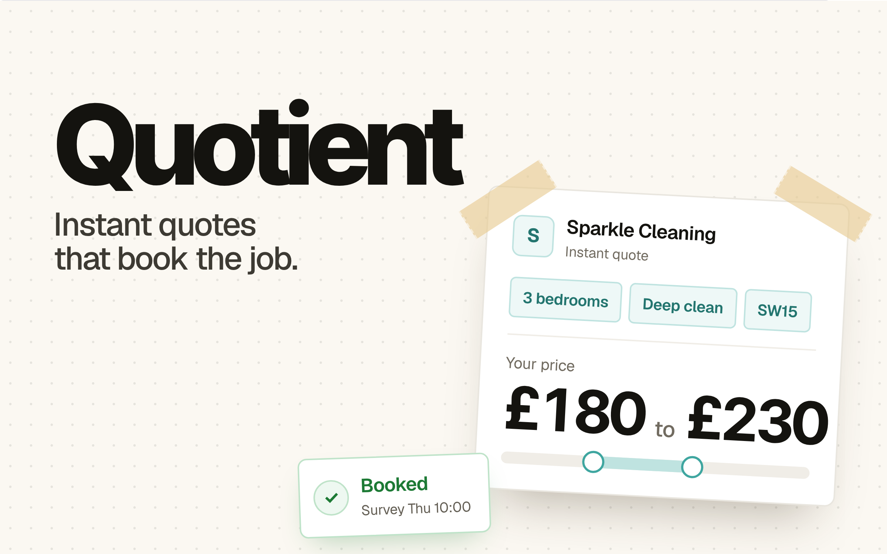

- **Category:** Productivity & Booking
- **Tagline:** Instant quotes that book the job
- **Card description:** Trades businesses build a quote calculator for their website; customers see an instant price range, add photos and book a survey or the job with a deposit, while Quotient follows up by text and email.
- **Price:** from $39/mo after a 7-day trial
- **Extra APIs:** Claude API (Anthropic), Twilio (SMS), Stripe Connect
- **Build time:** about 30 hours · Advanced

**Why it sells:** A cleaner who gets 40 quote requests a month and replies a day late loses jobs to whoever answers first. Quotient answers in seconds, even at 9pm, and books the slot; one extra $300 clean a month pays for the $79 Crew plan almost four times over, while Jobber only adds online booking from about $129 a month [verify].

**Who it suits:** People who want a first B2B SaaS sold to a market they can find on Google Maps today: owner-run cleaners, window cleaners, gardeners, painters and removals firms, and the small web agencies that build their websites..

**Features**

- Quote calculator builder: per room, per m2, per hour, fixed prices, extras, minimum charge and postcode zones
- One-line embed for Wix, Squarespace, WordPress and Webflow, plus a hosted quote page and QR code
- Instant price range for customers, worked out on the server from your published prices
- Customer photos checked by Claude to flag jobs that need a site visit, without ever changing the price
- Book a survey or the job from your own hours, with an optional deposit paid to your own Stripe
- Leads inbox with New, Quoted, Booked, Won and Lost, notes, and text or email from the lead
- Automatic follow-ups by SMS and email that stop when the customer books, replies or opts out
- Analytics for quote-to-booking rate, average job value and lead sources, plus Agency workspaces for up to 10 businesses

**Plans**

| Plan | Price | Includes |
|---|---|---|
| Solo | $39/mo | 1 business, 1 seat, 1 calculator, 1 calendar, 120 instant quotes, 240 SMS credits and 240 AI photo checks a month, deposits, follow-ups, Quotient badge |
| Solo (yearly) | $390/yr | Same as Solo, 2 months free |
| Crew | $79/mo | 1 business, 3 seats, 5 calculators, 3 calendars, 350 instant quotes, 700 SMS credits and 700 AI photo checks a month, badge optional |
| Crew (yearly) | $790/yr | Same as Crew, 2 months free |
| Agency | $299/mo | Up to 10 client businesses, 10 seats, 30 calculators, 20 calendars, 1,000 quotes, 2,000 SMS credits and 2,000 AI checks a month pooled, badge optional |
| Agency (yearly) | $2,990/yr | Same as Agency, 2 months free |

### Retain

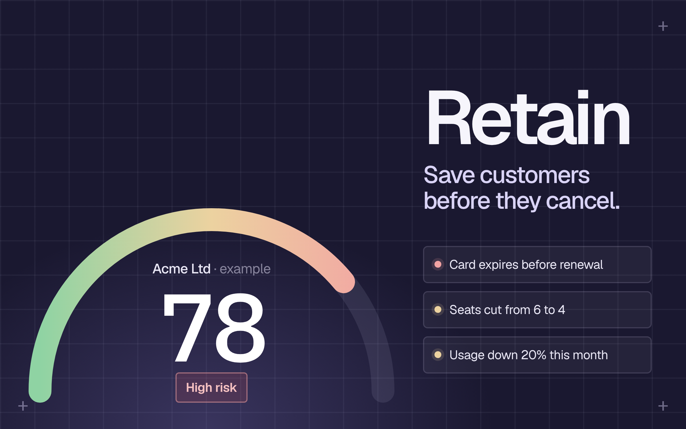

- **Category:** Business Tools
- **Tagline:** Save customers before they cancel
- **Card description:** Connect Stripe and Retain scores every customer for churn risk in plain words, recovers failed payments, runs a cancel flow with save offers, and drafts win-back emails with Claude.
- **Price:** from $49/mo after a 7-day trial
- **Extra APIs:** Stripe Apps (OAuth install), Claude API (Anthropic)
- **Build time:** about 32 hours · Advanced

**Why it sells:** A SaaS at $30k MRR with 5% monthly churn loses $1,500 of MRR every month. Recovering half the failed payments and saving one in five cancellers wins back about $450 of MRR a month, 3.5 times the $129 Growth plan, and every saved dollar keeps paying next month too.

**Who it suits:** Founders who want a first B2B SaaS sold to people they understand: other SaaS founders between $5k and $100k MRR who bill with Stripe and have no retention team..

**Features**

- Install the Retain Stripe App in two clicks: scoped permissions, no secret keys pasted anywhere
- A churn risk score for every customer from failed payments, downgrades, seat cuts, expiring cards, trials ending and usage drops, explained in plain words
- Optional usage tracking with a 1 KB JS snippet or a signed server webhook
- Failed-payment emails in your brand with a one-click update-card page, plus Smart Retries settings checked for you
- An embeddable cancel page with a reasons survey, tailored save offers (pause, discount, downgrade) applied in Stripe instantly, and an exit interview
- Win-back sequences for cancelled customers, drafted by Claude from their own usage history and sent through Resend
- A dashboard of MRR at risk, saved MRR, recovered payments and churn reasons over time
- Hard plan caps on every AI call and email, shown in the app before you reach them

**Plans**

| Plan | Price | Includes |
|---|---|---|
| Starter | $49/mo | Up to $10k MRR, 500 tracked customers, 500 AI risk summaries, 50 win-back drafts, 100 exit-interview tags, 500 emails and 250,000 usage events a month, 2 seats |
| Starter (yearly) | $490/yr | Same as Starter, 2 months free |
| Growth | $129/mo | Up to $40k MRR, 2,000 tracked customers, 2,000 risk summaries, 200 win-back drafts, 400 exit tags, 2,000 emails, 1M usage events, A/B test offers, 5 seats |
| Growth (yearly) | $1,290/yr | Same as Growth, 2 months free |
| Scale | $349/mo | Up to $100k MRR, 6,000 tracked customers, 6,000 risk summaries, 400 win-back drafts, 800 exit tags, 6,000 emails, 3M usage events, no Retain badge on the cancel page, 10 seats |
| Scale (yearly) | $3,490/yr | Same as Scale, 2 months free |
